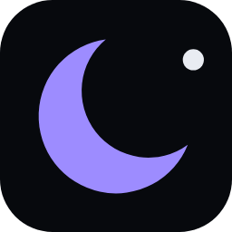

<div align="center">



# Nyxo Launcher

**A dark, private Android home screen that shows you what your apps are really doing.**

[](https://github.com/beworkall/nyxo/actions/workflows/build.yml)
[](LICENSE)
[](app/src/main/AndroidManifest.xml)
[](#install)

### [⬇️ Download the latest APK](https://github.com/beworkall/nyxo/releases/latest)

</div>

---

## Why Nyxo

Most launchers make your home screen prettier. Nyxo also makes it **honest**: every icon carries a small dot
that tells you, at a glance, whether that app can watch your screen, read your notifications or use your camera.

And it can't leak anything itself. The manifest has **no `INTERNET` permission**, so Android blocks every network
call Nyxo could ever make. You can check it yourself in [`AndroidManifest.xml`](app/src/main/AndroidManifest.xml).

## Features

| | |
|---|---|
| 🌑 **AMOLED black** | Pure black by default, or show your wallpaper with an adjustable dim. Six accent colours. |
| 🔴 **Privacy Radar** | Flags apps with an accessibility service, notification access, device admin, overlays, camera, mic, location, SMS or call log. Plain-language explanations and one tap to the right settings page. |
| 🕵️ **Hidden helpers** | Shows apps that have powerful access but **no icon** on your home screen, the way stalkerware usually hides. |
| 👍 **Thumb alphabet** | A letter strip on the screen edge. Slide your thumb along it: the letters swell around your finger and that letter's apps pop out beside it. Slide onto one and let go. Works left- or right-handed. |
| 🗂️ **Stacks** | Group apps (Social, Work, Games…) under one entry that opens in place. |
| 🏠 **Two home styles** | One-handed list (default) or a classic icon grid with a dock. Switch any time. |
| 🧭 **Guided setup** | First-run setup explains the privacy dots with your phone's real numbers and lets you choose to turn them on or not. |
| 🔎 **Offline search** | Apps, contacts (optional), settings pages, a calculator (`15% of 2400`, `(3+4)*2^3`) and unit conversions (`10 km to mi`, `70 f to c`, `2 gb to mb`). |
| 🔤 **A–Z scroller** | Jump through the app drawer by dragging along the letters. |
| ✋ **Gestures** | Swipe up for apps, swipe down or double-tap for search, swipe left/right to open any app, long-press for settings. |
| 🔒 **Hidden apps** | Hide any app from the drawer; the hidden list opens only with your fingerprint, face or screen lock. |
| 🚫 **No tracking** | No internet, no ads, no analytics, no accounts. |

## Install

1. Open [**Releases**](https://github.com/beworkall/nyxo/releases/latest) and download `Nyxo.apk`.
2. Open it on your phone and allow installs from your browser or file manager if Android asks.
3. Press **Home** and choose **Nyxo**, or open Nyxo and tap **Make Nyxo your home screen**.

Every push to `main` builds a new APK and publishes it to the latest release automatically.

### Permissions, all of them

| Permission | Why |
|---|---|
| `USE_BIOMETRIC` | Unlock the hidden-apps list with your fingerprint or face |
| `READ_CONTACTS` | Only if you turn on contact search. Asked at that moment, off by default |

That's the full list. No internet, no accessibility service, no device admin, no overlay, no uninstall rights.

## What the Privacy Radar checks

| Dot | Meaning |
|---|---|
| 🔴 | **Full access**: accessibility service on, notification access, or device administrator |
| 🟡 | **Sensitive access**: camera, microphone, location, SMS, call log, or drawing over other apps |
| none | None of the above |

The Radar reads permission state on the phone with standard Android APIs. It doesn't send, store or upload anything.
It also can't see everything: a one-time screen-recording session, for example, isn't a permission an app keeps.

## Build it yourself

Requires JDK 17 and the Android SDK (API 35).

```bash
git clone https://github.com/beworkall/nyxo.git
cd nyxo
gradle :app:assembleRelease
```

The CI workflow in [`.github/workflows/build.yml`](.github/workflows/build.yml) builds the same way on every push.

## Project layout

```
app/src/main/java/com/beworkall/nyxo/
├── MainActivity.kt          home activity, package-change listener
├── LauncherViewModel.kt     app list, navigation, placement
├── data/                    app loading, icon cache, settings
├── radar/PrivacyRadar.kt    on-device permission scan
├── search/                  search, calculator, unit converter
├── system/                  launching, settings shortcuts, biometric prompt
└── ui/                      Compose screens
```

## License

GPL-3.0. See [LICENSE](LICENSE).

<div align="center"><sub>Made by <b>BEwork</b> · <a href="https://github.com/beworkall">@beworkall</a></sub></div>
